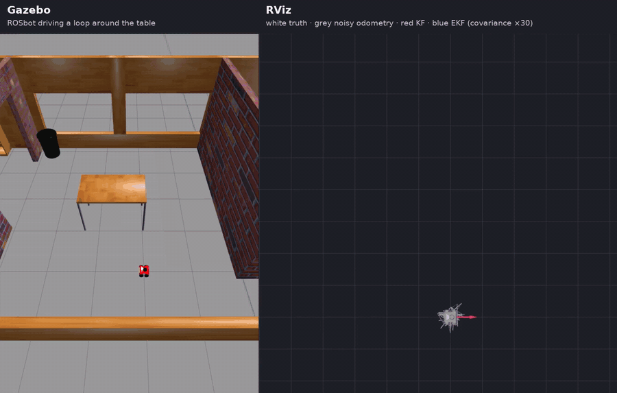
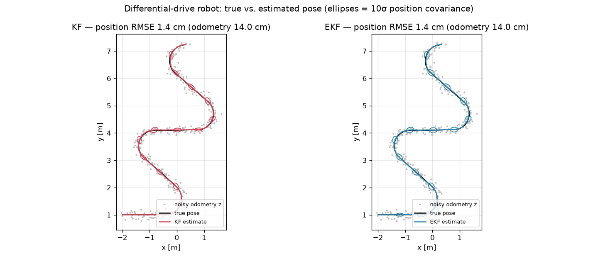

# Kalman Filter vs. Extended Kalman Filter for a Wheeled Robot



<sub>Recorded from the actual ROS nodes (ROS Noetic, Gazebo 11, RViz), sped up. Full-quality video:
[`docs/kf_vs_ekf_gazebo_rviz.mp4`](docs/kf_vs_ekf_gazebo_rviz.mp4).</sub>

A **Kalman filter (KF)** and an **extended Kalman filter (EKF)** written in C++ (ROS 1 + Eigen) that estimate
the pose `(x, y, θ)` of a wheeled mobile robot (ROSbot, driven like a differential drive) from its velocity commands and noisy odometry.
The robot is a Husarion ROSbot in a Gazebo house world. Each filter publishes its pose and covariance as a
`PoseWithCovarianceStamped`, and RViz draws it live.

In the recording, both filters run at the same time on the same inputs while the robot drives a loop around the table:
**white** = Gazebo ground truth, **grey** = noisy odometry fed to the filters, **red** = KF, **blue** = EKF.
The shaded ellipses are the position covariances, drawn 30× larger so they are visible.

## The model

**State and input**

```
x_t = [x, y, θ]ᵀ          u = (v, ω)   from /cmd_vel
z_t = [x, y, θ]ᵀ + δ,  δ ~ N(0, Q)     from /rosbot/odom (yaw from the quaternion)
```

**Motion model (unicycle, Euler step Δt = 0.02 s)**

```
x_t = x_{t-1} + Δt · v · cos θ_{t-1}
y_t = y_{t-1} + Δt · v · sin θ_{t-1}
θ_t = θ_{t-1} + Δt · ω
```

Process noise enters on the inputs, `ε ~ N(0, R)` with `R = diag(0.01, 0.01)`, mapped into state space by

```
      ⎡Δt·cos θ   0 ⎤
G_u = ⎢Δt·sin θ   0 ⎥
      ⎣   0      Δt ⎦
```

`R` is gated to zero when the measured velocities are zero, so the covariance does not grow while the robot stands still.
Measurement noise `Q = 0.01·I₃`, observation matrix `C = H = I₃`.

### KF — linear form

The nonlinearity is pushed into the input vector, giving a linear system with `A = I`, `B = Δt·I`:

```
u_KF = [v cos θ̂, v sin θ̂, ω]ᵀ
x̄ = A x̂ + B u_KF                  Σ̄ = A Σ Aᵀ + G_u R G_uᵀ
```

### EKF — linearised with the Jacobian

```
x̄ = g(x̂, u)                       Σ̄ = G_x Σ G_xᵀ + G_u R G_uᵀ

      ⎡1  0  −Δt·v·sin θ⎤
G_x = ⎢0  1   Δt·v·cos θ⎥   = ∂g/∂x
      ⎣0  0       1     ⎦
```

The Jacobians `G_x` and `G_u` were derived symbolically in MATLAB ([`matlab/KF_and_EKF.m`](matlab/KF_and_EKF.m)).

### Correction (both filters)

```
K  = Σ̄ Cᵀ (C Σ̄ Cᵀ + Q)⁻¹
x̂  = x̄ + K (z − C x̄)
Σ  = (I − K C) Σ̄
```

[`matlab/Covariance_Matrix_limit.m`](matlab/Covariance_Matrix_limit.m) iterates the covariance recursion to check
that Σ converges to a steady state instead of growing without bound.

## Results

**In Gazebo (video above).** On the straights, both filters smooth the noisy odometry (σ = 10 cm) to a few
centimetres around the true path. At the corners both estimates swing inward by up to ~0.4 m and are then pulled back.
The reason is that Gazebo's skid-steer robot turns less than commanded, while the filters predict with the commanded
`(v, ω)` and trust that prediction more than the noisy odometry (`R` small against `Q`). This is a real modelling
mismatch, not a bug in the recording, and the obvious next step would be to tune `R`/`Q` or use measured wheel
speeds as the input.

**Offline re-run.** [`sim/kf_ekf_sim.py`](sim/kf_ekf_sim.py) is a line-by-line **NumPy port of `KF.cpp` and `EKF.cpp`**
(same matrices, noise values, `dt = 0.02 s` and start pose) on an ideal unicycle with wheel slip. Without the model
mismatch, both filters cut the position error from 14.0 cm (raw odometry) to 1.4 cm:



With the KF written this way (heading folded into `u`), the **predicted mean is the same as in the EKF**; the
difference is in the **covariance**. With `A = I` the KF ignores how heading uncertainty turns into sideways position
uncertainty, so its ellipses stay narrow across the direction of travel. The EKF's `G_x` couples θ into x/y, so its
ellipses grow sideways, which is more realistic.

## Repository layout

```
ros_ws/src/gruppe2_bringup/   ROS 1 catkin package (package name kept from the course)
  src/KF.{hpp,cpp}            Kalman filter class
  src/EKF.{hpp,cpp}           Extended Kalman filter class
  src/*_node.cpp              nodes: subscribe /rosbot/cmd_vel + /rosbot/odom, publish KF_Position / EKF_Position
  launch/bringup_{KF,EKF}.launch   original: Gazebo + ROSbot + teleop + one filter node + RViz
  launch/demo_kf_vs_ekf.launch     demo: both filters side by side, noisy odometry, scripted loop
  rviz/, urdf/, meshes/, worlds/
matlab/                       symbolic Jacobian derivation and covariance-limit check
sim/kf_ekf_sim.py             offline NumPy re-run that generates the figures
docker/                       Dockerfile + scripts that record and compose the demo video
docs/                         video, GIF and figures
```

## Build and run

**ROS (built with ROS Noetic, Ubuntu 20.04)**

```bash
sudo apt install ros-noetic-desktop-full ros-noetic-turtlebot3-teleop ros-noetic-topic-tools libeigen3-dev xterm
cd ros_ws
catkin build            # or catkin_make
source devel/setup.bash
roslaunch gruppe2_bringup bringup_KF.launch    # or bringup_EKF.launch
```

Drive the robot with the keyboard in the teleop xterm. `topic_relay.sh` forwards `/cmd_vel` to `/rosbot/cmd_vel`.
The filter node prints the estimate, measurement and Σ, and RViz shows the estimate with its covariance.

**Re-record the demo video with Docker (no ROS install needed, also works on Windows)**

```bash
docker build -f docker/Dockerfile -t kf-ekf-demo .
docker run --rm --network none --shm-size=2g -v "$PWD/out:/out" kf-ekf-demo
docker run --rm -v "$PWD/out:/out" -v "$PWD/docker/compose_video.sh:/c.sh" kf-ekf-demo bash /c.sh
```

The container renders Gazebo and RViz on virtual displays and records them with ffmpeg. `demo_kf_vs_ekf.launch`
adds the demo pieces around the unchanged filter nodes:
- `script/demo_tools.py` drives the loop (a waypoint follower using Gazebo's pose, standing in for a person on
  keyboard teleop), adds the odometry noise, and publishes the path trails.
- `urdf/rosbot_fastsim.urdf` swaps the wheel collision meshes for cylinders so Gazebo runs close to real time
  without a GPU.

**Offline re-run (no ROS needed)**

```bash
pip install numpy matplotlib pillow
python sim/kf_ekf_sim.py
```

## Context

Solo project for the master's course MUS at FH Technikum Wien, 2021.

For this portfolio version the vendored Eigen copy was replaced by the system Eigen (`find_package(Eigen3)`), and
build output and generated Doxygen HTML were removed. The filter code is unchanged.

**Third-party assets:** the ROSbot URDF and meshes come from Husarion's `rosbot_description`, and `house.world` comes
from ROBOTIS' `turtlebot3_gazebo`. Both stay under their original licences. Everything else is MIT, see [LICENSE](LICENSE).
